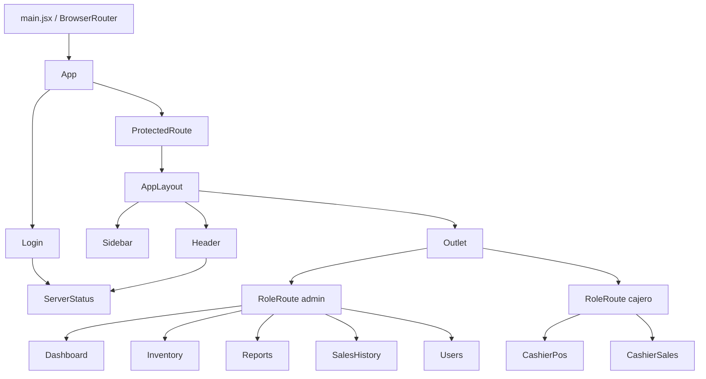

# Análisis de estado de SyncPOS Web

> **Borrador para revisar en grupo.** Corresponde a la actividad 3.4 (guía "Zustand en React con Vite", paso 3.2 B).
> Las decisiones de la columna "¿Debería ser global?" se pueden discutir y ajustar.

## 1. Árbol de componentes

```
main.jsx
└── BrowserRouter
    └── App                         (lee: user, para las redirecciones)
        ├── /login  -> Login        (usa: login, loading, error, clearError)
        │              └── ServerStatus
        └── ProtectedRoute          (usa: isAuthenticated)
            └── AppLayout           (usa: user.rol)
                ├── Sidebar         (usa: logout)
                ├── Header          (usa: user)
                │   └── ServerStatus
                └── Outlet
                    ├── RoleRoute allow="admin"   (usa: user)
                    │   ├── /dashboard   -> Dashboard
                    │   ├── /inventario  -> Inventory     (usa: useInventoryStore)
                    │   ├── /reportes    -> Reports
                    │   ├── /historial   -> SalesHistory
                    │   └── /usuarios    -> Users         (usa: user.id)
                    └── RoleRoute allow="cajero"  (usa: user)
                        ├── /punto-de-venta -> CashierPos  (usa: useCartStore)
                        └── /mis-ventas     -> CashierSales
```

Componentes de interfaz compartidos que no tienen estado global: `Button`, `Modal`, `Drawer`, `KpiCard`, `StatusPill`.

Versión en Mermaid (para pegar en una herramienta que la dibuje):



## 2. Datos compartidos y decisión

| Dato | Componentes que la usan | ¿Cómo se compartía antes? | ¿Debería ser global? |
|---|---|---|---|
| Usuario autenticado | `App`, `Header`, `Sidebar` (rol), `RoleRoute`, `Users` (no desactivarse a sí mismo), `Login` (a dónde ir) | `useState` en `App` pasado por props (`user`) a `AppLayout`, `Header`, `ProtectedRoute` y `RoleRoute`; `Users` lo leía de `localStorage` con `getSession()` | **Sí.** Lo necesitan componentes en ramas distintas del árbol y debe sobrevivir a recargar la página (`persist`). |
| Token de sesión | `services/api.js` (todas las peticiones), `ProtectedRoute` | Helpers `saveSession/getSession/clearSession` en `api.js` sobre `localStorage`, más el evento `syncpos:logout` para avisar a `App` de un 401 | **Sí.** Lo usa código que no es un componente (`api.js`) con `getState()`, y la interfaz debe reaccionar cuando se borra. |
| Carrito del cajero | `CashierPos` (catálogo, lista de venta, totales) | `useState` dentro de `CashierPos` | **Sí.** Aunque hoy lo usa un solo componente, debe sobrevivir a una recarga en medio de una venta (`persist`) y otras pantallas podrían mostrarlo (por ejemplo un contador en el menú). |
| Método de pago | `CashierPos` | `useState` dentro de `CashierPos` | **Sí.** Forma parte de la venta en curso; se guarda junto con el carrito. |
| Inventario (productos, filtros, página) | `Inventory` | Varios `useState` + `useEffect` dentro de `Inventory` | **Sí.** Agrupa datos que vienen de la API con loading/error y varias acciones (cargar, guardar, activar). Sin `persist`: debe venir fresco del servidor. |
| Categorías | `Inventory` (filtro y formulario), `CashierPos` (chips) | Cada página las pedía a la API por su cuenta | **Sí en Inventario** (están en `useInventoryStore`). `CashierPos` conserva su propia carga porque su catálogo no pasa por el store; queda como mejora futura unificarlas. |
| Estado del servidor (online / sin BD / offline) | `ServerStatus` (usado en `Header` y `Login`) | `useState` + `setInterval` dentro de `ServerStatus` | **No.** Solo lo usa ese componente, que lo consulta por sí mismo. Es un dato "de pantalla" que se renueva cada 30 s; no hay nadie más que lo necesite. |
| Valor recibido y cambio | `CashierPos` (panel de venta) | `useState` en `CashierPos` | **No.** Es un valor temporal de un input que solo le importa a ese panel (regla de la guía: Zustand no reemplaza a `useState`). |
| Modal abierto / formulario del modal | `Inventory`, `Users` | `useState` en cada página | **No.** Es estado de interfaz local de cada página; ninguna otra pantalla necesita saber si un modal está abierto. |
| Texto del buscador (lo que se escribe) | `Inventory`, `CashierPos`, `Users` | `useState` en cada página | **No.** Cambia con cada tecla y solo importa al input; el filtro ya confirmado (con debounce) sí está en `useInventoryStore`. |
| Datos de Dashboard, Reportes, Historial, Mis Ventas | Una sola página cada uno | `useState` + `useEffect` dentro de cada página | **No (por ahora).** Cada pantalla pide y muestra sus datos, nadie más los comparte. Se podría revisar si más adelante se reutilizan. |

## 3. Preguntas para el grupo

1. ¿El carrito debería mostrarse también fuera de `CashierPos` (por ejemplo un contador en el `Sidebar`)? Si sí, ya está listo en el store.
2. ¿Conviene mover las categorías a un store propio y que `Inventory` y `CashierPos` compartan la misma lista?
3. ~~¿Qué pasa con el carrito guardado si otro cajero inicia sesión en el mismo navegador?~~ **Resuelto:** al cerrar sesión (o si la sesión vence), `logoutLocal()` de `useAuthStore` vacía el carrito con `useCartStore.getState().clear()`, así el siguiente cajero empieza con el carrito vacío.
4. Un token en `localStorage` puede ser leído por scripts. ¿Qué cambiaría si el backend usara cookies `httpOnly`?
